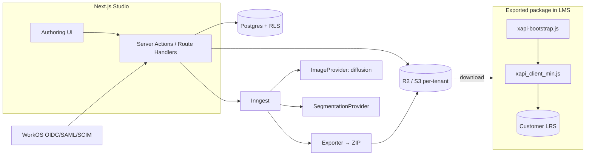

# Plan 1 — App Development Plan

> **Goal:** build a multi-tenant SaaS that authors realistic, explorable learning artifacts
> (image + interactive hotspots), versions and publishes them, and exports **xAPI / cmi5**
> static packages that run offline and stream statements to any LRS.
>
> **How to use this doc:** it is written to be executed *with Claude Code*. Each module has an
> intent, a data contract, and acceptance criteria. §7 gives copy-paste milestone prompts.

---

## 1. Product summary & the artifact engine

An **artifact** is a learning object. Its core is one (or several) realistic **scenes** — a raster
illustration — with an **interactive overlay** of **components** (hotspots). Learners explore the
scene; each component reveals learn-content and can carry an assessment. Every meaningful action
emits an xAPI statement.

```
Artifact
 └─ Version (immutable once Published)
     ├─ metadata (title, subject, IRI seed, language, license)
     ├─ pages[]            # ordered screens (a multi-page micro-lesson)
     │   └─ scene          # background image asset + viewport
     │       └─ components[]   # hotspots: rect | circle | polygon (normalized 0..1 coords)
     │            ├─ label, learn-content (rich text/media)
     │            ├─ xapi: { activityType, verbOnInteract }   # experienced/answered map
     │            └─ assessment?  (binds to a rubric item / interaction)
     ├─ rubrics[]          # scoring criteria; mastery thresholds
     └─ scoring            # how component answers roll up to passed/failed
```

### 1.1 Why "AI image + hotspot" needs a clear-eyed workflow

Text-to-image models output **pixels, not labeled parts**. The model does not know "this blob is
the magma chamber." So the authoring workflow is:

1. **Generate or upload** a realistic illustration (provider-abstracted; prompt presets per
   subject — "cutaway", "exploded view", "cross-section", "labeled-ready clean background").
2. **Author places components** by drawing regions on a normalized overlay.
3. **(Optional) Segmentation assist** — run a segment-anything-style model to *propose* regions
   the author accepts/edits. This is acceleration, never ground truth.
4. Coordinates stored as **normalized fractions (0..1)** of the scene so they survive any render
   size (authoring canvas, learner desktop, mobile). The renderer maps `0..1 → rendered px`.

> **Design implication for xAPI:** the *component* (not the pixel) is the addressable unit. Each
> component gets a stable IRI (§5) so statements are meaningful and version-comparable.

---

## 2. Recommended stack

You asked for a recommendation beyond your spec. Below is the recommendation with the *why*, then
the trade-offs and the alternative if you'd rather stay closer to your original RLS/OIDC/S3 spec.

### 2.1 Recommendation (and the reasoning)

- **Next.js 15 (App Router, React Server Components) + TypeScript** — one repo, one deploy for UI
  and API (server actions / route handlers). Streaming UI is ideal for *long* AI image jobs:
  show progress without blocking. Excellent Claude Code ergonomics.
- **WorkOS AuthKit** for OIDC — this is the upgrade over "OIDC login." Selling to schools and
  enterprises means you *will* be asked for **SAML SSO + SCIM directory sync + organization-scoped
  membership**. WorkOS gives that day one and maps directly to your roles (Owner/Admin/Author/
  Reviewer/Viewer). Auth0 is the equivalent alternative. (Rolling your own OIDC is not worth it.)
- **Postgres + RLS** (Neon serverless or Supabase Postgres) — keep your row-level tenant isolation,
  but add **service-layer guards** so isolation is *defense in depth*, not a single point of
  failure. RLS is the backstop; the service layer is the front door.
- **Drizzle ORM** — typed and SQL-transparent. A per-request helper opens a transaction and runs
  `SET LOCAL app.tenant_id = $1`, so every query is automatically tenant-scoped by RLS.
- **Cloudflare R2** for object storage (S3 API-compatible). **Zero egress fees** matters here:
  you serve a lot of image and asset bytes to authors and to exported packages. Per-tenant key
  prefixes + SSE encryption + short-lived signed URLs. AWS S3 is a one-line swap if you prefer.
- **Inngest** for background jobs — image generation, thumbnailing, ZIP export, and CI LRS launch
  tests are all async with retries. Durable functions beat hand-rolled queues.
- **AI image generation behind a provider interface** (`ImageProvider`) so you can swap diffusion
  vendors and add a segmentation provider without touching call sites.
- **Exported runtime is framework-free TypeScript bundled with esbuild.** The package must run
  offline on any LMS; shipping React into a SCORM-style zip is wrong. Author `xapi-runtime` in TS,
  bundle to a tiny ES module + the legacy `xapi_client_min.js`, copy into the package.
- **Zod + JSON Schema** for the observation document (one schema, runtime validation + generated
  TS types + the spec contract).
- **Vitest + Playwright** with **statement-snapshot** tests and **e2e launch tests** against a
  real test LRS (Learning Locker / Veracity) in CI.
- **Sentry + OpenTelemetry**; **immutable Postgres audit log** for sensitive operations.

### 2.2 Trade-offs / when to deviate

| Concern | Recommendation | Alternative & when |
|---|---|---|
| Managed auth vendor lock-in | WorkOS/Auth0 | Keycloak (self-host OIDC) if you must own identity / air-gapped. More ops. |
| Serverless cold starts on long jobs | Jobs on Inngest, app on Vercel | Single container on Fly.io/Render if you want one box and persistent workers. |
| R2 vs S3 | R2 (egress cost) | S3 if you're already AWS-committed or need a specific S3 feature. |
| RLS complexity with pooled connections | Drizzle + `SET LOCAL` inside a txn per request | Supabase client (RLS native) if you lean fully into Supabase. |

### 2.3 The exported package is its own mini-stack

The ZIP that runs in the LMS has **no dependency** on the authoring stack:

```
package.zip
├─ index.html              # loads bootstrap + client + app.js/app.css
├─ xapi-bootstrap.js       # LRS autodiscovery (no preconfigured creds)
├─ xapi_client_min.js      # queue/retry, idempotent IDs, 1.0.3 header
├─ app.js / app.css        # the artifact runtime (renders scene + hotspots, fires statements)
├─ tincan.xml | cmi5.xml   # manifest; activityId MUST equal runtime activityId
├─ assets/                 # images, fonts, media (all relative paths, offline)
└─ observation.json        # the published artifact document the runtime renders
```

---

## 3. Architecture overview



Trust boundaries (carried into the security plan): browser ↔ Studio API; Studio ↔ DB/R2/Inngest;
exported package ↔ customer LRS (the package never sees your infra or secrets).

---

## 4. Data model (Postgres + RLS)

Every tenant-owned table carries `tenant_id uuid not null` and an RLS policy keyed off
`current_setting('app.tenant_id')`. Core tables:

| Table | Purpose | Key columns |
|---|---|---|
| `tenants` | org/tenant | `id`, `slug`, `name`, `storage_prefix`, `created_at` |
| `users` | identity (mirror of OIDC subject) | `id`, `oidc_sub`, `email`, `email_hash` |
| `memberships` | user ↔ tenant ↔ role | `tenant_id`, `user_id`, `role` (enum), `status` |
| `artifacts` | logical artifact | `id`, `tenant_id`, `iri_seed`, `current_published_version_id`, `deleted_at` |
| `artifact_versions` | immutable on publish | `id`, `artifact_id`, `tenant_id`, `version`, `state` (draft/published/archived), `document jsonb`, `created_by`, `published_at`, `parent_version_id` |
| `assets` | uploaded/generated media | `id`, `tenant_id`, `artifact_id`, `r2_key`, `kind`, `content_type`, `sha256`, `width`, `height` |
| `exports` | export jobs/results | `id`, `tenant_id`, `version_id`, `profile` (xapi/cmi5), `r2_key`, `status`, `activity_id` |
| `rubrics` | reusable scoring | (often embedded in `document`; table if shared across artifacts) |
| `audit_log` | append-only | `id`, `tenant_id`, `actor_id`, `action`, `target_type`, `target_id`, `meta jsonb`, `at`, `prev_hash`, `hash` |
| `lrs_test_targets` | dev/CI LRS configs (never customer creds) | `id`, `tenant_id`, `endpoint`, `auth_ref` (secret pointer) |

**Versioning rules** (your spec):
- Soft-delete only (`deleted_at`), never hard delete authored content.
- `draft` versions are mutable; **`published` versions are immutable** (enforced by a trigger that
  rejects `UPDATE` on rows where `state='published'` except a controlled `archive` transition).
- Keep history + diffs: diffs computed on the `document jsonb` (JSON structural diff) for the
  version-compare UI.

**RLS pattern (Drizzle):**
```ts
// db/withTenant.ts — every request runs inside this
export async function withTenant<T>(tenantId: string, fn: (tx) => Promise<T>) {
  return db.transaction(async (tx) => {
    await tx.execute(sql`select set_config('app.tenant_id', ${tenantId}, true)`); // LOCAL
    return fn(tx);
  });
}
```
Policy example:
```sql
alter table artifacts enable row level security;
create policy tenant_isolation on artifacts
  using (tenant_id = current_setting('app.tenant_id')::uuid)
  with check (tenant_id = current_setting('app.tenant_id')::uuid);
```

---

## 5. IRI strategy (stable seeds)

Activity/component identity must be **stable across versions** so an LRS can aggregate, yet
**version-aware** where it matters. Recommended scheme (configurable base):

```
base = https://xapi.<your-domain>/<tenantSlug>
course (parent) activity   = {base}/artifacts/{artifactId}
artifact version activity  = {base}/artifacts/{artifactId}/v/{version}
page activity              = {base}/artifacts/{artifactId}/pages/{pageId}
component activity          = {base}/artifacts/{artifactId}/components/{componentId}
question (interaction) IRI  = {base}/artifacts/{artifactId}/components/{componentId}/q
```
- `artifactId`, `pageId`, `componentId` are **immutable UUIDv7-ish seeds** assigned at creation,
  carried forward across versions (so analytics persist when content is re-illustrated).
- The exported manifest `activityId` (tincan.xml / cmi5.xml) **must equal** the runtime's parent
  activity IRI — assert this in an export test.

---

## 6. Module breakdown

### 6.1 Authoring
- CRUD on artifacts and draft versions; the editor mutates `document jsonb` validated by the
  observation schema (`packages/schema`).
- Scene management: upload or generate background image → store in R2 → record `assets` row.
- Hotspot editor: rect/circle/polygon in normalized coords; per-component label, rich learn
  content, media, and the **xAPI mapping** (activityType + verb-on-interact).
- Rubric + scoring editor; mastery thresholds; roll-up rule (any/all/weighted → passed/failed).
- **Acceptance:** invalid documents are rejected by schema; coordinates persist as 0..1;
  preview renders identically to export at multiple sizes.

### 6.2 Versioning & publish
- `Draft → Published` snapshots the document immutably and assigns a `version`.
- History list + side-by-side document diff; restore = create a *new* draft from an old version.
- **Acceptance:** published versions cannot be edited; diff renders added/removed/changed nodes.

### 6.3 Exporter (`packages/exporter`)
- Input: a published `artifact_version` + profile (`xapi` | `cmi5`).
- Steps: collect assets from R2 → render `index.html`/`app.*` → copy bundled
  `xapi-bootstrap.js` + `xapi_client_min.js` from `packages/xapi-runtime/dist` → template
  `tincan.xml` or `cmi5.xml` (activityId = parent IRI) → embed `observation.json` → zip.
- Deterministic output (stable file order, no timestamps in content) so exports are diffable.
- **Acceptance:** package runs from `file://` offline (except LRS calls); manifest activityId
  matches runtime; opening `index.html` renders the artifact with working hotspots.

### 6.4 xAPI runtime (`packages/xapi-runtime`) — the exported brain
- **`xapi-bootstrap.js`** — *no preconfigured creds*. Autodiscovery chain, in order:
  1. **cmi5 fetch** (cmi5 `fetch` URL → auth token),
  2. **LaunchR** (`xAPILaunchService` + `xAPILaunchKey`),
  3. **`window.LMSLaunchData`**,
  4. **URL params** (`endpoint`, `auth`, `actor`, `registration`, `activity_id`),
  5. **manifest / well-known** (dev only — gated behind a build flag).
- **`xapi_client_min.js`** — builds 1.0.3 statements, **queues + retries** on network failure
  (exponential backoff, persisted to `localStorage`), **idempotent statement IDs** (UUID per
  logical event, so retries de-dupe at the LRS), sets the `X-Experience-API-Version: 1.0.3`
  header, prefers `actor.account`.
- Statements: `initialized` on start; `experienced` per page/component view; `answered` per
  assessment; `completed`/`passed`/`failed` with `score` + ISO-8601 `duration`. Context carries
  `registration` UUID, parent activity, `platform: "Observation Builder"`, and
  `language: navigator.language`. (Templates in your spec §D — encode them as the canonical
  builders here.)
- **Acceptance:** statement-snapshot tests lock the JSON shapes; offline → online flush replays
  the queue exactly once per event.

### 6.5 Multi-tenancy
- `withTenant()` wraps every request; RLS policies on all tenant tables; R2 keys prefixed
  `t/{tenantId}/...`; encryption at rest on the bucket.
- A **tenant-isolation test suite**: seed two tenants, attempt cross-tenant reads/writes through
  the service layer *and* raw SQL with the wrong GUC → all denied. (Security plan §2.)

### 6.6 Auth & RBAC
- WorkOS OIDC; on login, upsert `users` + resolve `memberships` for the active tenant/org.
- Roles → permissions matrix (security plan §4); enforce at **route** (middleware) and **object**
  level (service guards check role + tenant + resource ownership).
- Audit log on sensitive ops (publish, export, role change, delete, LRS config change).

---

## 7. Build phases

Each milestone is independently demoable. The prompt block is what to paste into Claude Code.

### M0 — Foundations
Monorepo (pnpm workspaces), Next.js app, Drizzle + first migration, Zod/JSON schema package,
CI (lint/typecheck/test), `CLAUDE.md`, `.claude/` settings. **Demo:** app boots, CI green.

> *Claude Code:* "Scaffold the monorepo per README layout: pnpm workspaces with `apps/studio`
> (Next.js 15 + TS + App Router), `packages/{schema,db,xapi-runtime,exporter,ui}`. Add Drizzle to
> `packages/db` with a `tenants`/`users`/`memberships` schema and one migration. Wire CI
> (typecheck, vitest, eslint). Create CLAUDE.md from the conventions in the dev plan."

### M1 — Authoring + observation schema
Observation document Zod+JSON schema; artifact/draft CRUD; hotspot editor (rect first);
normalized coords; preview. **Demo:** create artifact, place hotspots on an uploaded image,
preview.

### M2 — Versioning & publish
Immutable publish (trigger), history, document diff, soft-delete. **Demo:** publish v1, edit
draft → v2, view diff.

### M3 — Exporter + runtime
`packages/xapi-runtime` (TS → esbuild), `packages/exporter` (ZIP, tincan.xml/cmi5.xml), offline
render. **Demo:** export ZIP, open `index.html`, hotspots work offline.

### M4 — xAPI launch + LRS e2e
Bootstrap autodiscovery chain; client queue/retry/idempotency; Playwright launch tests vs
Learning Locker/Veracity; statement snapshots. **Demo:** package launched against test LRS emits
correct statements; offline→online replays once.

### M5 — Multi-tenant + RBAC + audit
RLS everywhere, `withTenant`, R2 prefixes, role matrix, route+object guards, audit log,
tenant-isolation test suite. **Demo:** two tenants fully isolated; role enforcement; audit entries.

### M6 — AI image + hotspot assist
`ImageProvider` + `SegmentationProvider` behind interfaces; Inngest jobs; prompt presets;
segmentation-suggested regions. **Demo:** generate scene, accept suggested hotspots, edit.

### M7 — Hardening
Security plan execution (CSP, headers, rate limits, upload safety, SSRF guards), perf, a11y pass,
load test, SBOM + SCA, docs. **Demo:** `/security-review` clean; WCAG AA pass; package validates.

---

## 8. Testing strategy

- **Unit (Vitest):** schema validation, scoring roll-up, IRI builders, statement builders, diff.
- **Statement snapshots:** golden JSON per verb (`initialized`/`experienced`/`answered`/
  `completed`/`passed`/`failed`) — fail on any shape drift.
- **Integration:** `withTenant` + RLS (cross-tenant denial); exporter produces a valid, offline,
  manifest-consistent ZIP.
- **e2e (Playwright):** launch an exported package against a containerized **Learning Locker** (or
  Veracity) in CI with a mock secret; assert statements landed and match snapshots; assert
  offline-queue replay.
- **Contract:** validate `tincan.xml`/`cmi5.xml` against the cmi5/xAPI schemas; assert
  `activityId` equality runtime↔manifest.

---

## 9. Driving this in Claude Code

- **`CLAUDE.md`** at repo root encoding: stack, the RLS `withTenant` rule ("every DB access goes
  through `withTenant`; never query without a tenant GUC"), the "published versions are immutable"
  rule, "no secrets ever in `packages/xapi-runtime` or any export output", coordinate
  normalization rule, and the statement-snapshot discipline.
- **Slash commands** in `.claude/`: `/new-migration`, `/export-smoke` (build a sample package and
  open it), `/lrs-e2e` (spin test LRS + run Playwright), plus the built-in `/security-review`.
- **Subagents:** an `Explore` agent for cross-package reads; a focused agent per milestone.
- **Hooks:** post-edit hook running `tsc --noEmit` + `eslint` on changed packages; a pre-commit
  hook blocking commits if `packages/exporter` output contains anything matching a secret pattern.
- **Worktrees:** use `isolation: "worktree"` when running parallel milestone work.

---

## 10. Open questions / decisions to confirm

1. **Image provider** — which diffusion vendor(s)? (Affects cost, content-safety, licensing of
   generated art for commercial reuse — confirm output license permits resale in packages.)
2. **Segmentation assist** — in-house model vs hosted API vs skip for v1.
3. **cmi5 vs xAPI default** — which is the primary export profile for your buyers' LMSs?
4. **Self-host option** — do enterprise buyers need an air-gapped/self-hosted deployment (changes
   auth + storage choices)?
5. **Accessibility of visual artifacts** — required conformance level (WCAG AA assumed); drives
   the alt-content authoring requirement (see UI/UX plan §a11y).
6. **Asset/illustration licensing & provenance** — store generation prompt + model + license per
   asset for auditability and IP defensibility.
